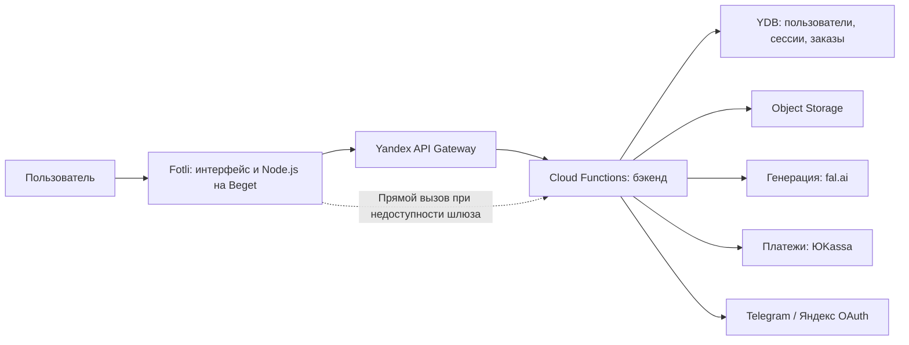
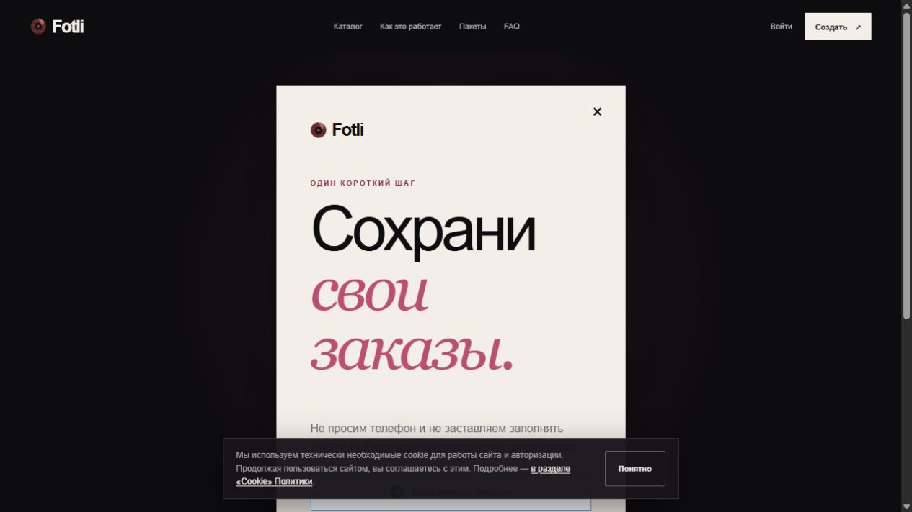

# Fotli — ИИ-фотосессии без студии

**Веб-сервис, в котором пользователь выбирает образ, загружает фотографии лица и получает персональную ИИ-фотосессию.**

Личный продуктовый проект: от каталога образов и сценария заказа до авторизации, облачной инфраструктуры и поддержки работающего сайта. Разработка велась с помощью AI-инструментов, включая Codex и Kimi.

> Этот репозиторий сохраняет кейс независимо от доступности домена. Здесь опубликованы скриншоты, описание архитектуры и восстановленный серверный адаптер. Полные исходники фронтенда и облачного бэкенда в репозиторий не входят.


## Сценарий продукта

1. Выбрать женский или мужской образ в каталоге.
2. Добавить фотографии лица: анфас и профиль.
3. Войти через Telegram или Яндекс ID.
4. Использовать токены для заказа генерации.
5. Получить результат в личном кабинете и скачать его.

Интерфейс предлагает качество 2K, пакеты токенов и ориентировочное время генерации 3–7 минут. Эти параметры отражают описание продукта, а не результаты нагрузочного тестирования.

## Что реализовано в проекте

- Главная страница, каталог с фильтрами и отдельные страницы образов.
- Подготовленные сценарии генерации: пользователю не нужно писать промпт.
- Вход через Яндекс OAuth и Telegram-бота.
- Загрузка фотографий с проверками формата, размера и лица в клиентском коде.
- Личный кабинет, заказы и баланс токенов.
- Интеграции генерации, платежей и хранения файлов.
- Административные операции, журнал действий и механизмы идемпотентности.

Состав функций подтверждён интерфейсом, клиентской сборкой, конфигурацией облака и структурой базы. Не все сценарии повторно проверялись при подготовке кейса: платежи и генерация не запускались.

## Технологии и архитектура

| Слой | Технологии |
| --- | --- |
| Интерфейс | React, сборка vinext/Vite |
| Веб-сервер | Node.js 22, Beget, Apache / Phusion Passenger |
| API | Yandex API Gateway, Yandex Cloud Functions |
| Данные | Yandex Managed Service for YDB |
| Фотографии | Yandex Object Storage, загрузка по подписанным URL |
| Авторизация | Яндекс OAuth, Telegram Bot API |
| Интеграции | fal.ai, ЮKassa |



## Практический кейс: восстановление авторизации

В октябре 2026 года API Gateway перестал принимать соединения. Фронтенд не мог получить список провайдеров входа и показывал отключённые кнопки «настраивается».

Диагностика установила, что сама облачная функция доступна. В Node.js-адаптер добавлен альтернативный транспорт: прямой вызов функции с `integration=raw`, передачей HTTP-запроса как события и преобразованием ответа обратно в HTTP.

При этом сохраняются методы, параметры URL, тела запросов, cookies сессий и перенаправления OAuth. Способ подключения выбирается переменной окружения, поэтому можно вернуться к шлюзу без изменения клиентской сборки.

После установки исправления проверены ответы API, начало входа через Яндекс и Telegram; владелец проекта подтвердил успешный вход на сайте.

[Подробности устройства адаптера →](ARCHITECTURE.md)

## Скриншоты

### Каталог образов


### Страница выбранного образа


### Авторизация



## Что лежит в репозитории

```text
server.js                         # Реальный серверный адаптер, реквизиты обезличены
.env.example                      # Шаблон конфигурации без секретов
package.json                      # Команды проверки и запуска адаптера
proxy-check.mjs              # Проверка HTTP-транспорта без облачных ключей
passenger.htaccess.example # Пример настройки Passenger
ARCHITECTURE.md                   # Техническое описание
home.png, catalog.png, style.png, auth.png # Скриншоты продукта
```

## Проверка кода

Нужен Node.js 22 или новее. Внешние зависимости для проверки не требуются.

```bash
npm test
node --check server.js
```

Тест проверяет параметры запросов, передачу cookies, POST-тела, OAuth-перенаправления, несколько cookies ответа, HEAD и бинарные ответы. Он использует подставной HTTP-транспорт и не обращается к рабочему облаку.

## Ограничения восстановления

Исходные локальные папки проекта были удалены. На хостинге сохранились серверный адаптер и собранный фронтенд; облачный бэкенд размещён отдельно. Этот репозиторий — презентация кейса и доступной части кода, **не полный комплект для запуска сервиса с нуля**.

Для запуска `npm start` дополнительно нужны оригинальная сборка в `dist/`, настроенный бэкенд и собственные реквизиты. Они не входят в публичный репозиторий. Рабочие ключи, базы, фотографии пользователей и облачные секреты не публикуются.

## Автор

Личный проект [dericfcsm-collab](https://github.com/dericfcsm-collab). Сайт проекта: Fotli.ru. Скриншоты сохранены 14 октября 2026 года; доступность рабочего сайта может измениться.
